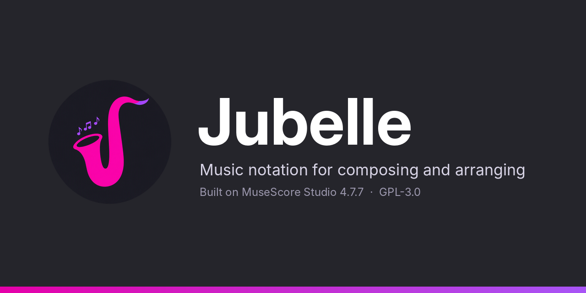

# 

**Jubelle** is a music notation application for composing and arranging, with a particular focus on
jazz and big-band writing. It is a personal project, developed in the open, and built on the
open-source engine of [MuseScore Studio](https://github.com/musescore/MuseScore) 4.7.7.

[](LICENSE.txt)

> **Status:** in active development. **Release candidate 1** (Windows and macOS) is available from
> [Releases](https://github.com/nlinemusic/stavelle/releases). It is a testing release; features are
> listed below only as far as they have been built and checked.

## Download

Get the latest version from **[Releases](https://github.com/nlinemusic/stavelle/releases)**:

- **Windows 10 or 11 (64-bit):** download the `.msi` and run it. The installer isn't code-signed yet,
  so SmartScreen may warn you: choose **More info › Run anyway**.
- **macOS:** download the `.dmg`, open it and drag **Jubelle** to **Applications**. The app isn't
  notarised yet, so the first time, Control-click it and choose **Open**.

**If your browser won't download it** (Edge: "isn't commonly downloaded"), or the Mac won't open it,
the release page has step-by-step help, including one-line commands that download it with PowerShell
or Terminal instead.

Jubelle installs alongside MuseScore Studio and doesn't touch its files or settings. Each release
carries a signed checksum list; on Windows, Jubelle's updater (Help › Check for updates) installs
only releases signed with Jubelle's release key.

## What Jubelle adds

Jubelle keeps everything MuseScore Studio 4.7.7 can do, and adds:

### Arranging
- **Harmonise Melody** (Tools › Arranging): voices a melody for trumpets, trombones and saxophones
  over the score's chord symbols, following the Pandemonium Big Band arranging lessons. It covers
  closed voicing and full-band soli, shout-chorus trumpet triads, the nine saxophone-section voicings,
  passing-note treatments and alterations on the V chord. Each choice is previewed, compared and
  undone in one step.
- **Linked passages:** music that stays in sync across staves while each keeps its own pitches.
- **Chord identification** with chord symbols and Roman numerals.
- **Condensed score copy** for winds and brass (a2, shared stems, "1." and "2.").

### Proofreading and parts
- **Proofread score:** ranges, spelling ("looks like a third, sounds like a second"), section
  voicing, time to change instrument, collisions, part preparation and copying checks.
- **Prepare Parts** (Format) and **Export for Library** (File): numbered part files, an
  instrumentation list and a folder index.
- **Page-turn optimisation**, **Apply Part Layout** and **title-page alignment**.

### Engraving and layout
- **Automatic courtesy accidentals** with your own rules and presets.
- **Collision avoidance and magnetic layout**, with **engraving rules** by instrument, group or score.
- **Engraving presets**, and a music-font chooser with a sample of each font.

### Playback
- **Articulation playback** you can set for the whole score, per instrument or per passage, with the
  default shown beside every value you change.
- **Jazz articulations:** falls, doits, bends, lifts, smears, flips, valve trills and the jazz turn.
- **Swing feels**, including a Basie-style feel, and **repeat playback** controls.
- **Glissando start** for each glissando.
- **VST3:** audio plugins on the Plugins page (switch each on or off, rescan, plain error messages),
  with per-instrument key switches, level trim and pitch-bend range.

### Timeline, selection and tempo
- **Timeline** with custom markers, a playhead and play-from-here.
- **Find and Select** for advanced selections.
- **Record tempo:** tap, follow, or use a MIDI key or pedal, then review and correct the result.

### Export and sharing
- **Video (MP4):** printed-looking pages on white, no cursor or title screen, your own page order with
  thumbnails and preview, and sound in time with the pictures.
- **Audio export** at 48 or 96 kHz, 16 or 24-bit.
- **Drum stems:** each drum component as its own audio file.
- **Publish to YouTube** (sign-in on Google's page, upload permission only).

### Projects, help and reliability
- **Jubelle Projects:** a library with categories, a standard folder for each composition, exports
  saved next to the score, and a picture on each project card.
- **New Score:** composition name, category and suggested templates in one setup screen, plus
  Jubelle templates (Big Band, Little Big Band, Jazz Octet, Studio Orchestra and more).
- **Learning Center:** guides, tutorials, and instrument ranges by family with transpositions.
- **Crash-safe saving**, local crash reports that are sent only if you choose, and a signed updater.
- **Performance profiles** (Preferences › General) and Jubelle's own interface themes.

**Coming next:** live score condensing, after this release has been tried.

## Compatibility

- Jubelle reads and writes standard MuseScore files (`.mscz`, `.mscx`). Scores made in Jubelle open
  in MuseScore Studio 4.7.7.
- Jubelle installs and runs alongside MuseScore Studio, with its own settings, so neither affects
  the other.
- **Platforms:** Windows 10 and 11 (64-bit); macOS (Apple Silicon and Intel), which is newer and not
  yet tried by hand.

## Building

Jubelle builds the same way as MuseScore Studio. The repository's GitHub Actions workflows produce
the Windows installer:

- **Build: Windows** and **Build: macOS**, started manually, make the `.msi` installer and the `.dmg`
  disk image, and run Jubelle's application, video and audio checks.
- **Jubelle: publish a release** signs and publishes a tested build (see `tools/jubelle_release/`).
- **Check: Unit Tests** compiles the whole application on Linux and runs the test suite.

To build on your own machine, follow MuseScore's
[developer environment guide](https://github.com/musescore/MuseScore/wiki/Set-up-developer-environment).
The steps and dependencies are the same.

Jubelle's own fast test tools, which need no Qt and no build minutes:

```sh
cmake -S tools/jubelle_engine_tests -B build-engine-tests -GNinja && cmake --build build-engine-tests
build-engine-tests/jubelle_engine_tests
```

## Repository layout

| Path | What it is |
|---|---|
| `src/` | The application. Jubelle's own code is mostly in `jubelle/` subfolders (for example `src/notation/internal/jubelle/`) |
| `share/` | Templates, instruments, styles and other installed data |
| `branding/` | Jubelle's logo sources and artwork |
| `tools/jubelle_*` | Jubelle's test tools |
| `docs/upstream/` | MuseScore's original README, contribution guide and GitHub templates, kept for reference |
| `.github/workflows-upstream-disabled/` | MuseScore's own CI workflows, kept but switched off |

## Relationship to MuseScore

Jubelle is derived from MuseScore Studio, by MuseScore Limited and its contributors, and stays
compatible with it. MuseScore's copyright notices, licence headers and third-party attributions are
kept unchanged throughout the source code. MuseScore™ is a trademark of MuseScore Limited. Jubelle is
an independent project and is not affiliated with or endorsed by MuseScore Limited or Muse Group.

Jubelle does not include or use the proprietary MuseSounds libraries.

## Licence

Jubelle is licensed under the **GNU General Public License version 3**, like MuseScore Studio; see
[LICENSE.txt](LICENSE.txt). Bundled fonts and third-party components keep their own licences, found
next to each component (for example in `fonts/` and `thirdparty/`).

## Contributing and feedback

See [CONTRIBUTING.md](CONTRIBUTING.md). Please read it before opening an issue, especially the
section on **not posting private scores or diagnostic files** in public issues.
