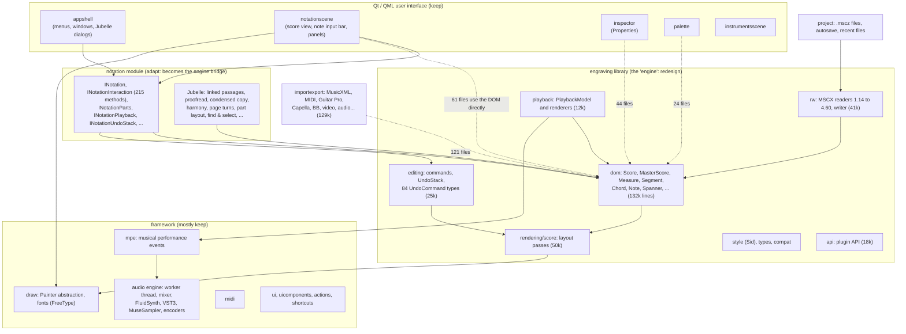

# 01 · Architecture audit: MuseScore Studio 4.7.7 as Jubelle uses it

Phase 1 deliverable. Examined from the Jubelle source tree at `baa6fdb5` (main after release candidate 2) and from the
MuseScore 4.7.7 baseline commit `d82ef7e0`. Line counts are C++ (`.cpp` + `.h`), third-party code excluded.

The aim here is to understand **how the systems work together**, the coupling that decides what can be replaced,
and where time and memory go. Each section ends with a verdict: **keep**, **adapt** or **redesign**.

---

## 1. The big picture

**The most important structural fact:** the `notation` module's `INotation*` interfaces look like a boundary
around the engine, but they are not a complete one. 317 source files outside the engraving library include its
DOM headers directly: the score view, Properties, palettes, every importer and exporter. An engine change can't be
hidden behind `INotation` alone. This decides the migration strategy (see `03_engine_architecture.md`, §7).

---

## 2. Score data structures and music representation (`engraving/dom`, 132k lines) · **redesign**

### How it is built
- **One object tree per score.** `EngravingObject` (identity, parent, properties, links) → `EngravingItem` (position,
  bounding box, layout data, drawing) → about 150 concrete element classes (`Chord`, `Note`, `Rest`, `Slur`,
  `Hairpin`, `Dynamic`, `Harmony`, …).
- **Time-ordered skeleton:** `MasterScore` → `MeasureBase` list (`Measure`, frames) → `Segment`s (one per
  rhythmic position and kind: ChordRest, Clef, KeySig, TimeSig, BarLine, …) → an element per *track*
  (track = staff × 4 voices).
- **Spanners** (slurs, hairpins, ottavas, pedals, lines) live in an interval tree (`SpannerMap`) keyed by tick.
- **Time** is a rational `Fraction` of a whole note, with integer ticks (480 per quarter) for indexing.
- **Instruments:** `Part` → `Staff` (one or more) → `Instrument` changes over time; `StaffType` covers standard,
  tablature and percussion.
- **Parts (excerpts) are complete second scores.** Each part is its own `Score` with its own copy of every element
  it shows. Elements are joined across scores by `LinkedObjects`, so an edit is repeated in every linked copy.
- **Layout results are stored inside the musical objects.** MuseScore 4 has started to separate them (every item
  has `ldata()` / `mutldata()`), but systems, pages, positions, shapes and many layout decisions are still members
  of the same objects, and layout also *modifies the DOM*: `modifydom.cpp` and `layoutFinished` create, move and
  delete elements during layout.

### What works well (worth keeping as ideas, and as code where practical)
- The segment grid (one column per rhythmic position) is a sound basis for spacing and for playback.
- `Fraction` timing is exact and safe for tuplets.
- The property system (`Pid`, defaults from the style, "use default") gives uniform editing and undo.
- The style system (`Sid`) is complete, and Jubelle's settings already live in it.

### What limits Jubelle
1. **Parts are copies.** Memory grows with the number of parts. The 39-staff orchestra uses 115 MB in the engine
   alone. Every edit is applied to every linked copy and then laid out in each one, and linking bugs are a known
   source of corrupted scores.
2. **Model and layout are mixed.** Layout changes the model, so "what the music is" and "how it looks now" can't
   be cached or computed separately, can't be computed on another thread, and can't be shown in two ways at once.
   That last point is exactly what live condensing needs.
3. **Pointers everywhere, no stable IDs.** Elements are found by pointer and by `(tick, track)`. Undo keeps
   pointers to deleted elements, and nothing can be referenced safely across a reload or between scores.
4. **One staff holds one instrument's music.** A chord belongs to one staff and one voice. Two players' notes can't
   share a stem. This was the hard blocker for live condensing found in the 17 Nov investigation, and it is
   structural, not a missing feature.

---

## 3. Engraving and layout (`rendering/score`, 50k lines) · **redesign the driver, adapt the algorithms**

### How it works
1. `Score::update()` → `doLayoutRange(startTick, endTick)` → `ScoreLayout::layoutRange`.
2. The range is **widened**: every spanner that overlaps it extends it to its whole length (a 100-bar pedal line
   or ottava makes every edit inside it lay out 100 bars). Jubelle widens it by one more measure when its courtesy
   accidentals are on.
3. `ScorePageViewLayout::layoutPageView`:
   - starts at the **system** containing the first changed measure, one measure earlier for clefs and courtesy
     signs;
   - **erases every system from there to the end of the score** (`prepareScore`);
   - lays out measure by measure (`MeasureLayout::getNextMeasure` → `SystemLayout::collectSystem` →
     `PageLayout::collectPage`);
   - stops only when a page ends on the same measure as before (`rangeDone && lmb == pageOldMeasure`). An edit that
     changes one system's width can therefore cascade to the end of the score.
4. Within that: chord and note layout, accidentals, beams, stems, slurs and ties (Bézier), horizontal spacing
   (`horizontalspacing.cpp`), vertical skylines and autoplace for markings, system and page stacking (`alignment`,
   vertical justification), then `layoutFinished` (spanners across systems, measure numbers, etc.).
5. Everything runs **on the main thread**, single-threaded.

### Measured (Engine Baselines, 15 Nov 2026; Release build, engine only)
| Score | Staves × bars | Full layout | One note entered | Undo |
|---|---|---:|---:|---:|
| Dawn (orchestra) | 13 × 19 | 25 ms | 8.4 ms | 8.4 ms |
| Big Score | 26 × 216 | 399 ms | 16.8 ms | 18.6 ms |
| Large orchestra | 39 × 285 | 1,429 ms | **121 ms** | **137 ms** |
| Big band chart | 18 × 40 | 132 ms | 34 ms | 30 ms |

On the largest score one edit costs 10–15 times what it costs on the 13-staff score, much more than the size
difference explains. The driver's "erase from this system on and lay out until stable" behaviour, the spanner
widening, and per-part repetition (each open part is laid out too) are the reasons visible in the code.

### Verdict
- **Algorithms worth adapting:** beam and stem rules, accidental stacking, Bézier slur shaping, skylines and
  autoplace, horizontal spacing formulas, padding tables. These represent years of engraving refinement; they are
  GPL and can be reused (see `05_licensing.md`).
- **Redesign:** the driver (invalidation, caching, ordering, threading) and the place layout results live.
  Layout must read an immutable musical model and write a separate, cacheable result.

---

## 4. System and page layout, and spacing · **adapt**
- System breaking is greedy, measure by measure, with locks (`editsystemlocks`), break elements and
  measures-per-system. There is no global optimisation, so one more measure can move every later break.
- Spacing: per-segment minimum widths, then stretch to the system width with a duration-based curve. Sensible, and
  measure-local: ideal for caching.
- Vertical: staff distances from style, skyline-based spacing, then vertical justification on the page.
- Jubelle adds magnetic rows, collision avoidance and engraving rules (`rendering/score/jubelle/`, about 1.5k lines)
  as passes on top of autoplace.

**New engine:** keep the spacing model; make widths per measure cacheable (keyed by content); break systems with a
global, stable method (best-fit over a window, with locks respected) so a small edit doesn't move breaks far away.

---

## 5. Instruments and staves · **adapt**
- `instruments.xml` (data), `Part`, `Staff`, `Instrument`, instrument changes, transposition, staff types (standard,
  TAB, percussion with drumsets).
- Concert and written pitch: notes store both (`pitch`, `tpc1`/`tpc2`).
- **New engine:** keep the data and the transposition rules; introduce **Player** (a person reading a part) as
  distinct from **Instrument** (what they play, possibly several over time) and **Staff** (where the music is
  drawn, a presentation concept). That separation is what makes condensing and divisi natural (see `04_…`).

---

## 6. Playback and audio rendering · **keep the audio engine, redesign event generation**
- `engraving/playback`: `PlaybackModel` walks the score segment by segment. Renderers (notes, ornaments,
  glissandi, arpeggios, tremolos, chord symbols) produce **MPE** events: musical events with articulation metadata,
  not raw MIDI. It updates by tick and track range after each edit, then sends whole tracks to the audio side.
- `framework/mpe`: articulation profiles, dynamics and expression curves.
- `framework/audio`: a separate **audio engine thread** with sequencer, mixer, FX, FluidSynth (SoundFonts), VST3,
  MuseSampler (MuseSounds; proprietary and not used by Jubelle), and offline rendering to WAV, FLAC, MP3, OGG and AAC.
- Jubelle: articulation playback profiles, swing feels, jazz falls and bends, repeat controls, even instrument
  levels, the look-ahead limiter, dynamics mapping, VST3 extras, drum stems.
- Measured: the playback model takes 376 ms on the largest score.

**Verdict:** the audio engine, MPE, synths and encoders are good and already thread-separated: **keep**. Event
generation is rewritten against the new model, measure-cached, with the same MPE output, so the audio side
doesn't change.

---

## 7. MIDI · **keep**
MIDI input (note input, Jubelle's tempo tapping with a MIDI key or pedal), MIDI file import and export
(`importexport/midi`). Unaffected by the engine change, except that export reads the new model through the bridge.

---

## 8. Rendering and graphics · **adapt**
- `framework/draw`: a `Painter` abstraction (Qt backend, plus PDF, SVG and PNG backends); fonts through FreeType
  with SMuFL metadata.
- The score view (`NotationPaintView`, a `QuickPaintedView`) paints visible pages by walking the element tree and
  calling each item's draw code (`rendering/score/paint.cpp`).
- **New engine:** the layout result becomes a **display list** (glyphs, lines, Béziers, text runs with IDs). The
  view paints the display list through the existing `Painter`, so PDF, SVG, PNG, print and MP4 export keep working.
  Hit-testing and selection use the same list. This also enables tile caching.

---

## 9. Text, symbols, articulations and other notation · **adapt**
- Text: `TextBase` with styled fragments, about 40 text styles, frames.
- Symbols: SMuFL (`SymId`), many music fonts (Leland, Bravura, Petaluma, Jubelle's jazz look, …).
- Articulations, ornaments, fingering, lyrics, chord symbols (`Harmony` with `chordlist.xml` realisation),
  fretboard diagrams, harp pedal diagrams, tremolos, arpeggios, breath marks, and so on.
- **New engine:** represent these as attachments on events, or as spanners over time ranges, with properties in the
  same `Pid`/style vocabulary, so the Properties panel keeps its meaning.

---

## 10. Undo and redo (`editing`, 25k lines) · **redesign**
- `UndoStack` of `UndoMacro`s, each a list of low-level `UndoCommand`s (84 kinds: `ChangeProperty`, `AddElement`,
  `RemoveElement`, `ChangePitch`, `InsertTime`, …). Commands hold pointers to elements, and deleted elements are
  kept alive inside the stack.
- Every model change must be wrapped by hand. A change made outside the undo system silently breaks undo; this is a
  recurring bug class.
- `CmdState` collects the dirty tick range and layout flags for the following layout.
- Linked elements (parts, Jubelle linked passages) are changed through `undoChangeProperty` and friends, which fan
  out to every link.
- Jubelle adds a command hook (`jubelleCmdHook`: before and after each command) for linked passages, in the same
  undo step.

**New engine:** edits are **transactions** on the model that record a **change set** (before/after per field, by
stable ID). Undo applies the inverse change set. The same change set drives layout and playback invalidation, the
autosave journal, and later collaboration or diffing. No element pointers in the history.

---

## 11. Loading, saving and compatibility (`rw`, 41k lines) · **keep for compatibility, add a native path**
- `.mscz` is a ZIP containing `score.mscx` (XML), `Excerpts/*.mscx` (one per part, 4.x), `audiosettings.json`,
  `viewsettings.json`, `automation.json`, `chordlist.xml`, images and a thumbnail.
- Readers for every historic format: `read114`, `read206`, `read302`, `read400`, `read410`, `read460`, and the
  current writer (format 4.70). `compat` holds migrations.
- Jubelle stores its own data where MuseScore ignores it: style values (`Sid::jubelle…`), score meta tags
  (`jubelleSwing`, `jubelleArticulationPlayback`, `jubelleCondenseOverrides`, `jubelleTempoPoints`, …), one
  property (`JUBELLE_PLAY_REPEAT`), and a few element-level attributes. Scores stay openable in MuseScore 4.7.7
  (checked by the coexistence test).
- Measured: saving the largest score takes 1,320 ms, about as long as a full layout, because every part is written
  in full as well.

**Verdict:** MuseScore-format compatibility is a **hard requirement** (see `03_…`, §8). Keep MuseScore's readers as
the import path for old formats (through the DOM-to-model converter). Write a native reader and writer for the
current 4.x format against the new model, verified byte-for-byte for round trips on the test corpus.

---

## 12. Performance and memory
| Area | Evidence | Cause in the code |
|---|---|---|
| Editing large scores | 121 ms per note on 39 × 285 | system-onward relayout, spanner widening, open parts laid out too |
| Undo | 137 ms | same layout path, plus pointer-based reverse operations |
| Saving | 1,320 ms | full XML for the score and every part |
| Playback model | 376 ms | walks the changed range across all tracks, then whole tracks are sent again |
| Memory | 115 MB engine-only | parts as full copies; layout data in every element |
| Threading | n/a | layout and editing on the main thread only; the audio side is already separate |

---

## 13. Extensibility and plugins · **keep the plugin API through the bridge**
- QML/JavaScript plugins with the `engraving/api` object model (18k lines), and the newer `extensions` framework
  (manifest, actions, UI).
- The plugin API mirrors DOM classes. Under the new engine it is served by the bridge (API objects wrap new-model
  IDs). Plugins are part of compatibility testing.

---

## 14. Jubelle's additions in this architecture
See `02_jubelle_integration_map.md` for each feature: where it hooks in, what it stores, and how it moves to the new
engine. In summary:
- **Engine-level** (engraving): courtesy accidentals (a layout rule), engraving rules, magnetic layout, overlap
  checker, jazz look style, articulation playback, swing feel, jazz falls, repeat play flags, and DOM touches in
  about 38 files (about 2,000 lines).
- **Notation-level** (on top of the DOM): linked passages (command hook), condensed-copy builder and planner,
  harmony system, chord identifier, proofread, find and select, part layout, prepare parts, page turns, page
  alignment, template page, tempo tapping, timeline markers, drum stems, instrument reference, swing marking.
- **Audio-level:** dynamics mapping, preset gains, ensemble trim, safety limiter, dither, bend shaping, VST3 key
  switches.
- **App-level** (independent of the engine): projects, templates, Learning Center, crash guard, updater, bug
  report, workflow profiles, performance profiles, YouTube, video export UI.

In all, 688 files changed (+72k, −21k lines) since MuseScore 4.7.7. The engraving core changes are small and
localised. Most of Jubelle sits on top of the DOM, which is good for migration: those features need the bridge's
API, not MuseScore internals.

---

## 15. Summary: keep, adapt or redesign
| System | Decision | Why |
|---|---|---|
| Qt/QML interface, Jubelle UI | **keep** | the interface must stay recognisably Jubelle |
| Audio engine, synths, VST3, encoders, MPE | **keep** | already separate, threaded and tested; recently improved |
| draw (Painter, fonts, PDF, SVG, PNG) | **keep** | display-list renderer targets it |
| MSCX readers (all versions) | **keep** as the import path | compatibility; huge and proven |
| Importers and exporters (MusicXML, MIDI, …) | **keep** via the converter | rewrite only if needed later |
| Style vocabulary (`Sid`), properties (`Pid`), instruments data, SMuFL | **adapt** | the same names keep files and the UI meaningful |
| Engraving algorithms (beams, stems, accidentals, slurs, spacing, skylines) | **adapt** (port) | refined; GPL allows reuse |
| Score DOM | **redesign** | parts as copies, mixed model and layout, no stable IDs, one player per staff |
| Layout driver | **redesign** | cascade, no caching, single thread |
| Undo | **redesign** | pointer commands; manual wrapping |
| Playback event generation | **redesign** (same MPE output) | measure caching, incremental |
| notation façade | **adapt** into the engine bridge | the UI keeps its interfaces |
