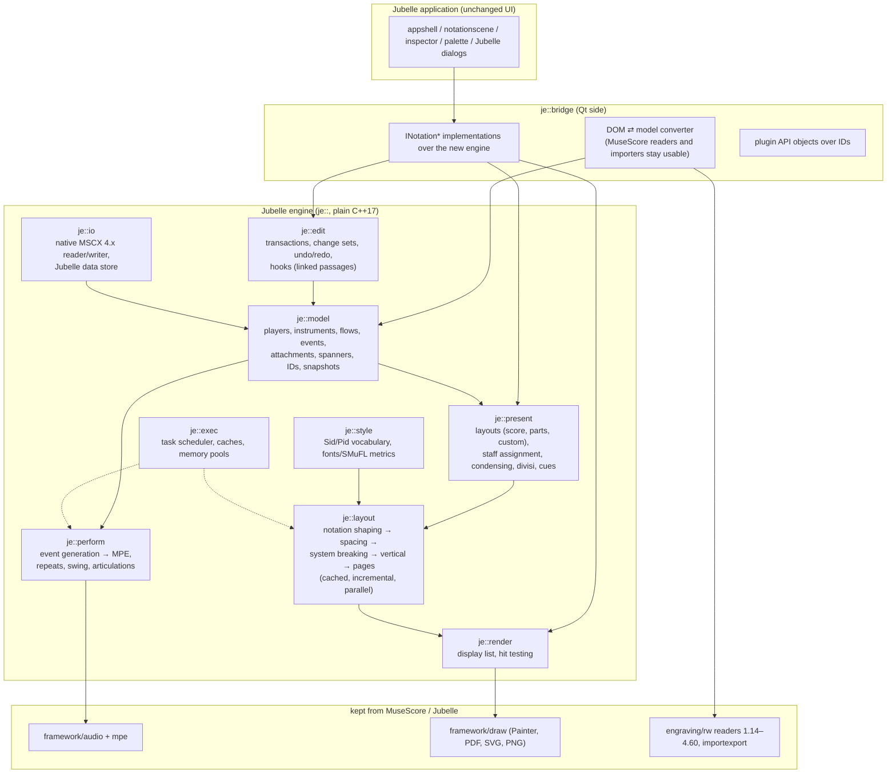
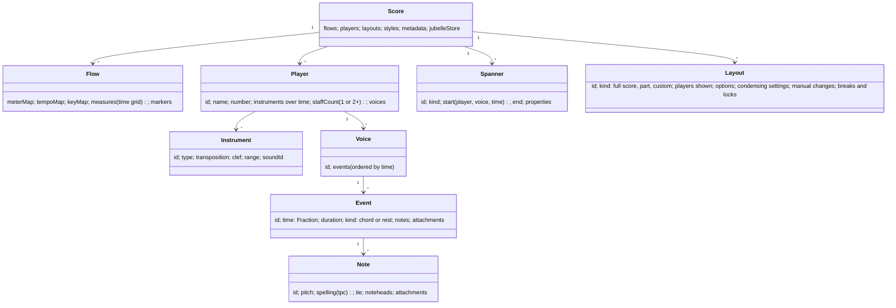
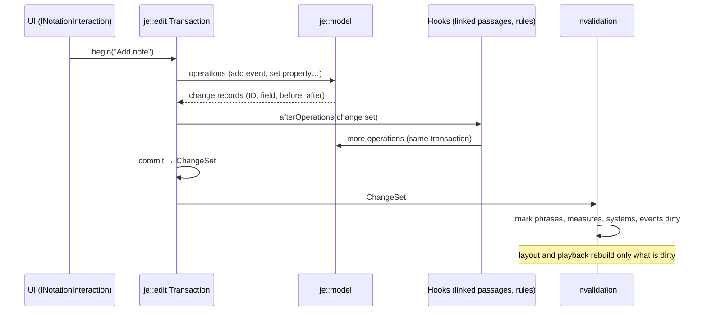
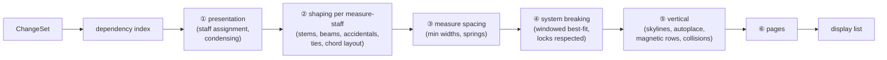

# 03 · The Jubelle-native engine: architecture

Phase 2 deliverable (first version). It describes **what** the engine is and **why**. Each module's detailed
interface is written when its implementation phase starts, and recorded in `07_decisions_log.md`.

## 1. Principles
1. **Same Jubelle, new engine.** The interface, menus, workflows and file format stay the same. Users see faster
   editing and new capabilities (live condensing), not a different program.
2. **Music, presentation and layout are separate layers.** What the music *is* (players, notes, timing,
   markings) is never changed by how it is *shown* (full score, parts, condensed staves) or by where it *lands*
   (positions, systems, pages).
3. **Everything visible is derived and cached.** Presentation and layout are pure functions of the model plus
   settings, cached per piece (phrase, measure, system) and invalidated precisely by change sets.
4. **Stable identities.** Every musical object has a 64-bit ID that survives undo, reload (stored in the file
   where possible), and copying between layouts.
5. **Transactions, not hand-wrapped undo.** All edits go through transactions that produce change sets. Undo,
   redo, invalidation, autosave and Jubelle's hooks are all driven by them.
6. **Plain C++17, no Qt in the core.** As with Jubelle's existing tested logic: testable without the app, usable
   on any thread, portable. Qt appears only in the bridge.
7. **Incremental migration.** The new engine runs alongside MuseScore's (shadow mode) and takes over one
   subsystem at a time, with automatic comparison against MuseScore's results.

## 2. Layers and modules

| Module | Responsibility | Reuses |
|---|---|---|
| `je::model` | the music: score, flows, players, instruments, staves-of-a-player, voices, events (notes, chords, rests), attachments (articulations, dynamics, text), spanners, tempo and meter maps; IDs; immutable snapshots (copy-on-write) | `Fraction`, `Pid`/`Sid` names, instrument data |
| `je::edit` | transactions, change sets, undo/redo, edit operations (the command vocabulary of `INotationInteraction`), transaction hooks | MuseScore's edit semantics as the specification |
| `je::present` | **layouts** (full score, each part, custom layouts) with per-layout options; **staff assignment** (which player is drawn on which staff in which voice, per passage), including **condensing** and divisi; derived, never stored except settings and manual changes | Jubelle's condensing planner logic |
| `je::layout` | pipeline: notation shaping (stems, beams, accidentals, ties, slurs) → measure spacing → system breaking → vertical stacking and collision avoidance (skylines, magnetic rows) → pages | MuseScore's engraving algorithms, ported |
| `je::render` | display list per page and system (glyph runs, lines, paths, text) with element IDs; hit testing; dirty regions | `framework/draw` as the backend |
| `je::perform` | playback events per measure (cached) → MPE; repeats, swing, articulation profiles, falls and bends | MuseScore's renderers, Jubelle's playback rules |
| `je::io` | native reader and writer for MuseScore 4.x `.mscx`/`.mscz`; Jubelle data store; round-trip verification | MuseScore's writer as the specification |
| `je::style` | style values and defaults; music font metrics | `Sid`, style XML, SMuFL metadata |
| `je::exec` | thread pool, task graph, cache budget, memory arenas | n/a |
| `je::bridge` | Qt-side adapters: `INotation*` on the new engine, DOM ⇄ model converter, plugin API | `notation` module |

## 3. The data model

- **Player-centred, not staff-centred.** The music belongs to players. A staff is a presentation of one or more
  players' music on one layout. This is the change that makes condensing native.
- **Parts are layouts, not copies.** A part layout shows one player (or a few), with its own breaks, style
  overrides and text. There is one copy of the music, so nothing has to be kept in sync, and memory falls.
- **Per-layout properties.** A property may have a value per layout (for example a dynamic's position in the score
  versus in the part), stored as overrides keyed by layout ID. This replaces "linked but unlinked" excerpt
  elements.
- **Time grid.** Flows own the measures (meter, barlines, repeats). Events are positioned by `Fraction` time and
  belong to voices of players. Segments (columns) are built by layout, not stored.
- **Snapshots.** The model is persistent (copy-on-write nodes per measure-of-voice). A snapshot is a cheap,
  immutable view for analysis, rendering, playback or saving on another thread while editing continues.

## 4. Edits, undo and hooks

- Undo applies the inverse change set; redo applies it again. History holds values and IDs, never pointers.
- Change sets also feed the autosave **journal** (crash recovery replays it on the last full save) and the
  "Jubelle data" store.
- Hooks are the official extension point for linked passages (and later others), inside the same undo step.

## 5. Layout pipeline and incremental invalidation

- **Granularity:** ① per phrase and condensing group; ② and ③ per measure × staff (cache key: content hash of the
  inputs); ④ per window of systems; ⑤ per system; ⑥ per page.
- **Precise dependencies:** a spanner depends on the measures it spans, but changing one note under a slur
  re-shapes the slur only on the affected systems. The range is never widened to the whole spanner.
- **Stable system breaking:** breaks are chosen over a window (default: the page and the next one) with a cost
  function. An edit can only move breaks inside the window, unless the window's last break moves, in which case it
  continues one window at a time. This bounds the cascade that makes large-score edits slow today.
- **Threads:** ② and ③ are independent per measure-staff, ⑤ per system: they run in parallel on `je::exec`.
  Editing never waits for off-screen pages: visible pages are laid out first, and the rest finish in the
  background (with a "layout complete" signal before printing or export).
- **Determinism:** the same model and settings always produce the same layout, whatever the thread order. This is
  tested.

## 6. Playback
- Events are generated **per measure × player** from the snapshot (cached by content hash) and assembled into
  per-track MPE event maps. Only changed measures are regenerated and re-sent.
- Repeats are expanded by a playback-order map (Jubelle's repeat controls included). Swing, articulation profiles
  and jazz gestures are rules applied in generation.
- The output is the same MPE as today, so the audio engine, synths, VST3, mixer, limiter and exporters don't change.

## 7. Integration strategy: how the new engine enters Jubelle
The DOM is used directly by 317 files outside the engine (see `01_…`, §1). A big-bang swap is therefore not
realistic. The route:

1. **Shadow mode.** The bridge's converter builds the new model from MuseScore's DOM after each load and edit. The
   new layout and playback run in the background, and their results are **compared** with MuseScore's (positions
   within tolerance, systems, pages, MPE events). Nothing the user sees changes. This is the main test harness.
2. **Engine API.** Consumers that reach into the DOM (score view, Properties, palettes) are moved, one at a time,
   from DOM pointers to engine-neutral interfaces (IDs, property get and set by `Pid`, typed queries). MuseScore's
   engine implements those interfaces too, so each move is safe on its own.
3. **Opt-in switch.** Preferences › Advanced › *Use the Jubelle engine (experimental)*, per score, off by default.
   With it on, the new engine is the source of truth for that score. Saving writes standard MuseScore 4.x files
   through `je::io`. With it off, Jubelle is exactly the current release.
4. **Importers and exporters** keep using MuseScore's DOM through the converter (import into the DOM, then convert),
   until there is a reason to rewrite one.
5. **Default switch** only after Phase 7's compatibility and performance gates pass.

## 8. Compatibility requirements
- **Files:** read every format Jubelle reads today. Write MuseScore 4.x `.mscz` that MuseScore Studio 4.7.7 opens
  with the same music and layout intent. Jubelle-only data goes where MuseScore ignores it: today style values and
  meta tags; for larger data (condensing changes, layout-specific overrides), a `Jubelle/` folder inside the
  `.mscz` ZIP, which MuseScore ignores (to be confirmed by test).
- **Parts in files:** the file keeps MuseScore's `Excerpts/` so MuseScore sees normal parts. On load the new engine
  maps excerpts to layouts, and on save it writes them back.
- **Templates, plugins, palettes, workspaces, shortcuts:** unchanged.
- **Round-trip rule:** opening and saving without edits must produce a file that is musically identical
  (normalised XML comparison on the whole corpus).

## 9. Performance goals (engine only, Release build, same machine as the baselines)
| Measure | Today (39 × 285 orchestra) | Goal | Stretch |
|---|---:|---:|---:|
| One note entered | 121 ms | **≤ 16 ms** (one frame) | ≤ 8 ms |
| Undo one edit | 137 ms | **≤ 16 ms** | ≤ 8 ms |
| Full layout (open) | 1,429 ms | **≤ 700 ms** (visible pages ≤ 150 ms) | ≤ 400 ms |
| Save | 1,320 ms | **≤ 300 ms**, off the main thread | ≤ 150 ms |
| Playback update after an edit | part of 376 ms rebuild | **≤ 10 ms** | n/a |
| Engine memory | 115 MB | **≤ 70 MB** (no part copies) | ≤ 50 MB |
| Small scores | n/a | never slower than MuseScore | n/a |

The same benchmark tool (`tools/jubelle_engine_tests` baselines) measures both engines on the same scores.
