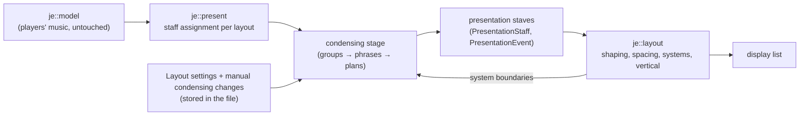

# 04 · Automatic condensing: technical specification for the Jubelle engine

**Status:** **approved for implementation** in the new engine (user, 18 Nov 2026), as subsystem S9 of the complete engine
(`14_full_engine_roadmap.md`). Not implemented in the MuseScore-based engine. Approved decisions: configurable
player groups (D-E12) and abbreviated labels such as "Tpt. 1.2" (D-E18).

## 1. Goals
1. In the full score, players of the same instrument (Flutes 1–2, Trumpets 1–4, Horns 1–4, …) share staves wherever
   the music stays readable, and get their own staves back where it doesn't (divisi), automatically.
2. **The music is never changed.** Each player's part stays complete and independent. Condensing is a way of
   *showing* the music, computed from it.
3. **Reversible at any level:** for the whole score (on/off), a condensing group, a passage, or a system, with no
   loss of data.
4. Readable engraving that follows accepted practice: a2 / a3, "1." / "2.", chords on one stem, two voices,
   player labels, divisi staves, staff labels that name the players present.
5. Parts are never affected: a part layout shows its player in full.
6. Fast enough to be live: an edit re-condenses only the phrases it touches.

## 2. What exists today, and what is reused
- **MuseScore 4.7.7 has no condensing.** It can hide empty staves per system ("hide when empty"), and it allows a
  staff to show only one instrument's music. Jubelle's investigation (17 Nov) confirmed that the MuseScore DOM
  can't put two players' notes on one stem: a chord belongs to one staff and one voice.
- **Jubelle's current condensed copy** (`notation/internal/jubelle/condensedscore.cpp`, `condensingplanner.cpp`)
  builds a separate `.mscz` with shared staves for **pairs** of woodwind or brass players. It holds the tested
  decision logic (a2, chords, two voices, 1./2., separate, divisi per system), the marking moves (dynamics,
  slurs, ties, hairpins), the labels and staff names, and 12 engine tests, including the 48-bar "every note
  still at the same time and pitch" test.
  - **Reused in the new engine:** the decision logic, as the core of the phrase classifier (§6), and every test,
    as golden tests.
  - **Not reused:** copying music into another score, and showing or hiding staves per system as the mechanism.
- **Dorico** (the reference for live condensing) splits the music into phrases and condenses each independently:
  condensing groups (adjacent similar instruments by default, or custom), phrases separated by rests, manual
  "condensing changes" from a rhythmic position, player labels, and staff labels on condensed staves that list
  every player present. It also documents a known side effect of per-phrase decisions (redundant a2/a3 labels),
  and it gives automated options precedence over manual assignments. Jubelle follows the same broad model, which
  matches its player-centred data model. It adds phrase smoothing (§6.4) against label noise.

## 3. Where condensing lives in the engine

Condensing is a **presentation stage** owned by `je::present`. It reads players' music and the layout's settings,
and produces **presentation staves**: the staves this layout draws, each listing which players' events it shows,
in which voice, and how.

## 4. Data model
### 4.1 Stored (saved in the file)
```text
LayoutCondensingSettings              (per layout; the full score has condensing off by default)
  enabled: bool
  groups: [CondensingGroup]           (proposed from the section defaults table, §5.2; fully user-editable)
  options: CondensingOptions          (§7)
  changes: [CondensingChange]         (manual overrides, ordered by time)

CondensingGroup
  id
  players: [PlayerId]                 (2..4, any compatible players chosen by the user, §5.3)
  sharing: automatic | staffSets: [[PlayerId]]   (explicit staff sets are kept whenever condensing applies)
  maxStaves: int                      (default: ceil(players/2))

CondensingChange                      (applies from `time` until the next change for that group)
  id, time: Fraction (flow position), groups: [GroupId]
  mode: automatic | separate | condense | manual
  manual: [ {player, staffIndex, voice: up|down} ]    (only for mode = manual)
  optionOverrides: CondensingOptions (partial)
```
Saved in the Jubelle data store (`03_…` §8), as stable IDs and flow positions (`Fraction`), **never bar numbers**,
so inserting bars doesn't shift them. That was a known limitation of the condensed copy. MuseScore ignores the data
and simply shows every player on their own staff.

### 4.2 Derived (never saved; rebuilt from the model and the settings)
```text
Phrase                 group, timeRange [start, end), events of each player in range, classification
StaffPlan              per phrase: assignment of players → (presentation staff, voice), mode, labels
SystemStaffSet         per system: the presentation staves drawn on that system for each group
PresentationStaff      id (derived, stable: hash(layout, group, index)), group, label text per system
PresentationEvent      time, duration, voice, source notes [(player, eventId, noteId)], merged attachments
```
- A **PresentationEvent** is the thing that can hold two players' notes on one stem. It **references** source notes
  and copies nothing, so selection, editing and playback always reach the real notes.
- IDs of presentation objects are derived deterministically, so selection survives re-condensing.

## 5. Condensing groups (configurable; nothing hardcoded)
**Decision (user, 18 Nov 2026):** which players condense together is **the user's choice**. The engine contains
no fixed pairings (no hardcoded "1+3 / 2+4"). It provides **sensible defaults per section**, and every default can
be changed per layout.

### 5.1 How groups are defined
- A **condensing group** is an ordered list of 2–4 players plus options (§7). Any players may be grouped if they
  pass the compatibility check (§5.3); the default proposals below are only a starting point.
- Groups belong to a **layout**: the full score can group Horns 1.2 and 3.4 while a custom "brass reduction" layout
  groups Horns 1.2.3.4.
- Within a group, **staff sharing** is also configurable: `sharing = automatic` (the engine chooses which players share
  a staff per phrase, fewest staves first) or an explicit list of **staff sets**, for example
  `[[Horn 1, Horn 3], [Horn 2, Horn 4]]` or `[[Horn 1, Horn 2], [Horn 3, Horn 4]]`, which the engine keeps to
  whenever it condenses.
- Manual condensing changes (§4.1) can still override any of this from a point in time.

### 5.2 Default proposals (applied when condensing is first turned on; editable afterwards)
| Section | Default proposal | Default sharing |
|---|---|---|
| Flutes, oboes, clarinets, bassoons (incl. 3rd players) | one group per instrument type, adjacent players (e.g. Flutes 1–3) | automatic; pairs in score order |
| Saxophones (big band) | **no condensing by default** (each saxophone usually has its own line); groups offered: Altos 1–2, Tenors 1–2 | automatic |
| Horns (2–4) | one group, Horns 1–4 | staff sets **[1+2] [3+4]**, following the staff order 1–4 (the high/low pairing [1+3] [2+4] is one choice away) |
| Trumpets (2–4) | one group, Trumpets 1–4 (big band: 1–4) | automatic; pairs in score order |
| Trombones (2–4), bass trombone | Trombones 1–3 as a group; a bass trombone joins only if the user adds it | automatic |
| Tubas, euphoniums | one group per instrument type | automatic |
| Strings, keyboards, voices, percussion, guitars, harp | not proposed (string divisi is a separate, later mechanism, §12) | n/a |

The proposals are stored as data (a defaults table in `je::present`, overridable by templates), not as code paths, so
they can change without touching the engine logic.

### 5.3 Compatibility check (what can share a staff)
Players can be grouped only if they have the same written transposition (or the layout is at concert pitch and the
"mix transpositions at concert pitch" option is on), a compatible staff type (standard, not TAB or percussion), and
single-staff instruments. An incompatible request is refused with a message naming the reason; nothing is silently
dropped.

### 5.4 Interface (for Phase 6)
Layout options › Condensing: turn on or off per layout; a list of groups with *Add group*, *Remove*, *Players…*,
*Sharing: automatic / staff sets*; *Restore section defaults*. All changes are undoable and stored with the layout.

## 6. The condensing algorithm
### 6.1 Phrase segmentation (per group)
A phrase is a stretch of time in which the group's texture is consistent. Boundaries come from:
1. rests in **every** player of the group at least `phraseRestThreshold` long (default: one beat, or one full bar
   of silence in any one player);
2. rehearsal marks, double barlines, key or meter changes, and flow starts;
3. manual condensing changes;
4. **system starts** (after the first layout pass, §9).

### 6.2 Classifying a phrase
For each phrase, and each pair of players in it, the classifier (ported from `condensingplanner`) decides the best
readable texture, in order of preference:

| Texture | Conditions (all must hold) | Engraving |
|---|---|---|
| **Tacet** | no player has notes | rests (or a multimeasure rest if the whole system is tacet) |
| **Solo** "1." / "2." | only one player has notes | that player's music, with a player label at the start |
| **Unison** a2/a3 | identical pitches, rhythms, ties and articulations (dynamics may differ, see 6.5) | one voice, "a2" (or "a3"…) label |
| **Chords** (homorhythm) | identical rhythms; no voice crossing (upper player ≥ lower at every attack); interval ≤ `maxChordSpan` (default an octave); compatible articulations and slurs; no second-player tuplets that differ | one voice, notes on shared stems |
| **Two voices** | each player uses one voice; at most two independent rhythms on the staff; no crossing for longer than `crossingTolerance` (default: none); compatible clefs | upper player stems up (voice 1), lower stems down (voice 2) |
| **Divisi** (separate staves) | any of: crossing; a player using several voices; more than two independent rhythms; incompatible tuplets; a range too wide for one staff; lyrics; dense independent markings; staff-specific clef changes | separate presentation staves for the players involved |

A group of 3–4 players is assigned by solving for the fewest staves where every staff passes one of the textures
above (exhaustive search is cheap for ≤ 4 players). With `sharing = staffSets`, only the user's staff sets are
considered: each set shares a staff when its music allows, otherwise it divides.

### 6.3 Voice and stem assignment
- Upper player (by player number) in voice 1, stems up; lower in voice 2, stems down. Both stay where they are for
  the whole phrase. No swapping mid-phrase.
- Rests: a rest shown only for the player who rests. When both rest at the same time and rhythm, one shared rest.
- Ties and slurs follow the voice of their player. Ties between a shared and a divisi system are drawn as
  continuations (§9.4).

### 6.4 Smoothing (readability over local optimality)
Per-phrase decisions can alternate too often (a2, 1., a2, chords…), and the labels become noise. That is the known
Dorico side effect noted in §2. Smoothing rules:
- a phrase shorter than `minPhraseLength` (default: one bar) takes the texture of its neighbour if that texture also
  fits it;
- an a2 → chords → a2 sequence inside one bar becomes chords for the whole bar;
- labels are repeated only where the texture changes, plus at each system start (§8).

### 6.5 Markings
| Marking | Rule |
|---|---|
| Dynamics, hairpins | identical in both players → one, placed below the staff. Different → each placed by its voice (voice 1 above, voice 2 below); in unison texture, different dynamics prevent a2 and give chords or two voices |
| Articulations | per note; unison requires identical articulations |
| Slurs, phrasing | per voice; identical slurs in chord or unison texture are drawn once |
| Text (playing techniques, mute, *solo*) | kept with their player, placed above (voice 1) or below (voice 2); "mute" in one player only → divisi, or a player label ("1. mute") |
| Lyrics | prevent condensing (vocal parts aren't condensed anyway) |
| Ottava | per player; a different ottava → divisi |
| Cues | not condensed |

### 6.6 Accidentals and transposition
- Accidentals are computed **for the presentation staff**, not per player. Two players on one staff share one
  accidental state per bar. A courtesy or cancellation that each player's own part wouldn't need may be required:
  for example player 1 has F♯, then player 2 has F♮ in the same bar. The accidental stage runs on presentation
  events and, with Jubelle's courtesy rules on, looks at the previous bar *of the presentation staff*.
- Every player in a group has the same written transposition, so written pitches combine directly. In concert-pitch
  layouts the concert pitches are used.
- Spelling (tpc) is each note's own. Condensing never respells.

## 7. Options (per layout, with per-change overrides)
| Option | Default |
|---|---|
| `enabled` | off for the full score (as decided earlier), on per user choice |
| `families` | woodwind, brass |
| `maxChordSpan` | octave |
| `allowCrossing` | no |
| `phraseRestThreshold` | 1 beat in all players, or 1 bar in one |
| `minPhraseLength` | 1 bar |
| `unisonLabel` | "a2"/"a3"; option "unis." |
| `soloLabels` | "1."/"2." (option: "Solo" text for a single player) |
| `restsForSilentPlayer` | show in two-voice texture; hide in solo texture |
| `sharing` (per group, §5.1) | automatic, or the user's staff sets |
| `staffLabelStyle` | "Trumpet 1.2" / "Trumpets 1.2" / stacked numbers |
| `condenseWhenSystemTacet` | yes (multimeasure rests across the condensed staff) |

## 8. Labels and staff names
- **Player labels** above the staff at texture changes: "a2", "1.", "2.", "1. 2." (in two-voice texture, only at
  the first entry after a change, and only when it isn't obvious). Their placement goes through skylines like any
  text.
- **Staff labels** at each system list the players on that staff on that system in the **abbreviated** form
  (decision D-E18): "Tpt. 1.2", or "Tpt. 1" and "Tpt. 2" on divisi systems. Full names ("Trumpet 1.2") stay
  available where the layout uses long names (the first system, by default), following its naming style.

## 9. Interaction with layout
### 9.1 The circularity, and how it is broken
Condensing wants to know where the systems break (staff count is fixed per system), and system breaks depend on
widths, which depend on condensing. The pipeline therefore runs:
1. **Pass A:** condense with phrases bounded only by musical boundaries (6.1 points 1–3); measure spacing; system
   breaking.
2. **Pass B:** add system starts as phrase boundaries; per system, take the **maximum** number of staves each group
   needs on any part of it (a system shows one staff set). Re-plan phrases on that system with the fixed staff set
   (a passage that could have been a2 but sits on a divisi system shows the players on their own staves with
   "a2"-free notation).
3. Re-space only the systems whose staff set changed. If a system's break moves, repeat for that window, at most
   `maxCondensePasses` (default 3), then **freeze**: keep the last staff set. This rule is already used by the
   current Jubelle design, so layout can't loop.

### 9.2 Spacing
Spacing runs on presentation staves. A shared staff's segment widths account for both voices: seconds, unisons,
dotted rhythms and offset noteheads.

### 9.3 Vertical layout and collisions
Each presentation staff is a normal staff for skylines, magnetic rows and Jubelle's collision avoidance. Player
labels and per-voice dynamics are registered as placed items.

### 9.4 Across system boundaries
Ties, slurs and hairpins that start on a condensed system and continue on a divisi system (or the reverse) are drawn
as continuation segments on the correct presentation staff of each system. The model's spanner is one object, and
the presentation draws its segments. This solves the condensed copy's limitation, which dropped them.

### 9.5 Page layout, page turns and frames
No special rules. Staff counts per system change the system heights, and page filling uses the real heights. Page
turns are a part concern; parts are never condensed.

### 9.6 Multimeasure rests
In the full score, a system where a whole group is tacet shows one condensed staff with the rest (if
`condenseWhenSystemTacet`). Multimeasure rests across the whole system follow the layout's normal option.

## 10. Editing, selection and expanding
- **Clicking** a note on a condensed staff selects its **source note** (both source notes for an a2 note, with
  Tab to cycle between players).
- **Editing:** every edit applies to the source notes through normal transactions. An edit on an a2 note asks once,
  per session, whether to change both players or only the clicked player (default: both, as players in unison
  expect). Note input on a condensed staff goes to the player of the selected voice (voice 1 → upper player,
  voice 2 → lower). For a solo phrase it goes to the soloist.
- **Expand:** commands *Show players separately* (here: a condensing change with `mode = separate` at the
  selection's phrase) and *Condense here* (`mode = condense`), plus *Reset to automatic*. All undoable, all stored
  as condensing changes, none touching the music.
- **Turning condensing off** for the layout shows every player on their own staff immediately. The settings and
  changes are kept for when it is turned on again.
- **View option:** *Show condensing* in the View menu toggles the score view between condensed and full without
  changing the layout setting (useful while entering music).

## 11. Parts, playback, export
- **Parts:** separate layouts with condensing off. A combined part (for example "Trumpets 1–2", one part for two
  players) is a layout with two players and condensing on. It needs no extra code.
- **Playback** reads players' music, never presentation. Condensing has no effect on sound.
- **MusicXML / MIDI export:** players' music (unchanged). A later option may export the condensed presentation to
  MusicXML.
- **PDF, print, MP4:** the layout as shown (condensed if on).
- **MuseScore compatibility:** a saved file opens in MuseScore with every player on their own staff, and nothing
  lost. The condensing settings ride along in the Jubelle data store.

## 12. Out of scope for the first version (designed for, not built)
- String divisi (one player splitting into several staves) uses the same presentation-staff mechanism in the
  opposite direction and is planned after condensing.
- Condensing different instruments (for example Flute 3 / Piccolo) on one staff.
- Three or more voices on one staff.

## 13. Performance
- Phrase plans are cached by `(group, phrase range, content hash of the players' events in range, options hash)`.
- An edit invalidates only the phrases containing the changed events (and neighbours, if a phrase boundary moves),
  then the systems containing them (§9.1 step 3).
- Goal: condensing adds ≤ 2 ms to an edit and ≤ 10% to a full layout of the 39-staff orchestra.

## 14. Testing (all automatic, before any visual review)
1. **No note lost** (ported 48-bar test plus a generated corpus): for every condensed layout, the multiset of source
   notes reachable from presentation events equals the players' notes, with the same time, pitch, duration and
   spelling.
2. **Reversibility:** condensing on → off → on gives identical presentation; the model is byte-identical throughout
   (no change set produced by turning condensing on or off).
3. **Classification golden tests:** ported from `condensingplanner` tests, plus new cases for 3–4 players, smoothing,
   per-voice markings, and accidental interplay between players (6.6).
4. **Layout convergence:** never more than `maxCondensePasses`; deterministic results across thread orders.
5. **Edit consistency:** random edit sequences on condensed scores, comparing incremental results against a full
   re-condense from scratch.
6. **Round trip:** save and reload keep the settings and changes, anchored by time, also after inserting or deleting
   bars before them.
7. **MuseScore check:** files with condensing settings open in MuseScore 4.7.7 with all music on individual staves.
8. **Visual review set:** big band, wind ensemble, classical orchestra and film-score samples for the user's review
   (PDF), with the condensed copy's earlier review notes as the checklist.

## References
- Dorico: [Condensing calculations and considerations](https://steinberg.help/dorico/v4/en/dorico/topics/page_formatting/page_formatting_condensing_calculations_considerations_c.html) (condensing groups, phrases)
- Dorico: [Condensing Change dialog](https://steinberg.help/dorico/v4/en/dorico/topics/page_formatting/page_formatting_condensing_change_dialog_r.html) and [Manually condensing players](https://steinberg.help/dorico/v4/en/dorico/topics/page_formatting/page_formatting_condensing_changing_manually_t.html)
- Dorico: [Staff labels on condensed staves](https://steinberg.help/dorico/v4/en/dorico/topics/notation_reference/notation_reference_staff_labels/notation_reference_staff_labels_condensed_staves_c.html)
- Steinberg forum: [unwanted a2/a3 from per-phrase condensing](https://forums.steinberg.net/t/condensing-unwanted-a2-a3/150872)
- Jubelle: `Jubelle - G2 Report (14 Nov 2026)` (condensed copy) and `Jubelle - Windows Build Refinement Phase: Assessment and Plan` §1.6 (live condensing investigation)
