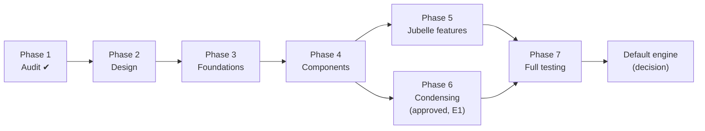

# 06 · Roadmap, dependencies and testing

The seven phases set by the user, broken into milestones with entry and exit criteria.

> **Priority changed on 18 Nov 2026 (D-E20):** the next testing build, **E1**, uses the new engine and includes
> condensing (approved). The work it needs comes first, in the order of `14_testing_build_e1_plan.md`; the phases
> below remain the full plan for later engine builds (E2: engine editing, undo and playback; E3 onward: native layout
> stages, then native file I/O).

## Phase 1 · Architecture investigation and technical audit · **done (18 Nov 2026)**
- `01_architecture_audit.md`, `02_jubelle_integration_map.md`, `05_licensing.md`.

## Phase 2 · Architecture and design · **done (18 Nov 2026)**
| Milestone | Content | Exit criterion |
|---|---|---|
| 2.1 | Engine architecture (`03_…`), first version | done (18 Nov) |
| 2.2 | Condensing specification (`04_…`), first version | done (18 Nov) |
| 2.3 ✔ | Detailed model specification (`09_model_mapping.md`): every element kind mapped from the DOM (property by property), IDs, per-layout overrides, snapshots | mapping table covers 100% of `ElementType` values used by the test corpus |
| 2.4 ✔ | Edit vocabulary (`10_edit_vocabulary.md`): every `INotationInteraction` operation → transaction operations | table complete; open questions listed |
| 2.5 ✔ | Layout pipeline interfaces (`11_pipeline_interfaces.md`): stage inputs and outputs, cache keys, dependency rules | reviewed against `01_…` §3 cascade cases |
| 2.6 ✔ | Bridge plan (`12_bridge_migration_plan.md`): the list of DOM consumers (317 files) grouped and ordered | ordering agreed in the decisions log |

## Phase 3 · Isolated environment and foundations · **in progress**
| Milestone | Content | Exit criterion |
|---|---|---|
| 3.1 ✔ | `jubelle_engine/` builds standalone (CMake, C++17, no Qt) with GoogleTest and a benchmark runner; a CI job on Linux (no app build needed) | `ctest` green in CI |
| 3.2 (started) | `je::exec` (thread pool ✔, task graph), `je::model` core types, IDs ✔, Fraction ✔, copy-on-write containers ✔, transactions and history ✔ | unit tests; snapshot isolation tests under ThreadSanitizer |
| 3.3 | DOM → model converter (in the engine test tool, which already links MuseScore's engine without Qt) | converts every score in the corpus; no element type left unmapped |
| 3.4 | Model → DOM converter, and the **round trip DOM → model → DOM**, compared by normalised MSCX | identical on the corpus |
| 3.5 (started) | Corpus: demos, Jubelle templates, test scores, the large orchestra, big band charts; the user's own scores locally only (D-E17: outside the repository, git-ignored backstop, CI guard) | documented in `corpus/README.md` ✔; benchmarks added with 3.3 |

## Phase 4 · Incremental implementation of engine components (shadow mode)
Order, by dependency and by value:
| # | Component | Compared against | Exit criterion |
|---|---|---|---|
| 4.1 | `je::edit`: transactions, change sets, undo/redo on the model | replaying MuseScore edit scripts in both engines → same model | 100% of scripted operations; undo/redo inverse property tests |
| 4.2 | `je::perform`: playback events → MPE | `PlaybackModel` output, event by event | identical events on the corpus (tolerances documented); edit update ≤ 10 ms |
| 4.3 | `je::layout` ②: shaping (stems, beams, accidentals, ties, chords) | MuseScore positions per element | within 0.05 sp on ≥ 99% of elements; differences reviewed |
| 4.4 | `je::layout` ③④: spacing and system breaking | MuseScore systems and measure widths | same breaks on ≥ 95% of systems in "MuseScore-compatible" mode; stable mode measured separately |
| 4.5 | `je::layout` ⑤⑥: vertical, skylines, pages | MuseScore page images | pixel-diff review set within threshold |
| 4.6 | `je::render`: display list → `Painter` | rendering through MuseScore | PDF/PNG image diffs within threshold |
| 4.7 | `je::io`: native 4.x reader and writer | MuseScore's writer | normalised-XML identical round trips; MuseScore 4.7.7 opens every written file |
| 4.8 | `je::bridge`: `INotation*` over the new engine; score view, Properties and palettes moved to the engine API | the full app check and interface self-test with the experimental switch on | all Windows and macOS app checks pass with the switch on |

Every milestone ships **behind the switch, off by default**. The released Jubelle keeps working unchanged.

## Phase 5 · Jubelle features on the new engine
In the order of `02_jubelle_integration_map.md`: playback rules (articulation, swing, falls, repeats) → courtesy
accidentals and engraving rules → magnetic layout and collision avoidance → linked passages (native) → harmony
system, chord identifier, proofread, find and select → part layout, prepare parts, page turns, title page →
timeline and tempo. Each feature's existing tests run against both engines.

## Phase 6 · Automatic condensing in the new engine · **approved 18 Nov 2026; in progress for E1**
Per `04_condensing_specification.md`: groups and phrases → classifier (ported) → staff plans → presentation
events → layout passes → labels → editing and expand commands → storage → tests (§14 of the specification) →
visual review with the user.

## Phase 7 · Compatibility, performance, reliability, cross-platform
- Corpus round trips, MuseScore 4.7.7 opening every written file, plugins, templates, workspaces.
- Performance gates (`03_…` §9) on Windows and macOS, both engines side by side.
- Reliability: fuzzed edit sequences, crash-recovery journal replay, memory (no growth over long sessions),
  ThreadSanitizer and AddressSanitizer runs.
- The user's hands-on testing on Windows and Mac.
- Decision record: switch the default engine, or not yet.

## Testing requirements (all phases)
1. **Two engines, one answer:** every engine component is checked against MuseScore's in shadow mode, with
   documented tolerances, before it is used for real.
2. **Golden corpus** (§3.5) used by every test level; results are tracked over time.
3. **Unit tests** for every module (GoogleTest, in `jubelle_engine/tests`), runnable in seconds without Qt.
4. **Property tests:** undo/redo inverses; incremental results equal full recomputation; determinism across thread
   orders.
5. **Benchmarks** (`jubelle_engine/bench`) comparing against `Jubelle - Engine Baselines (15 Nov 2026)`: no
   regression accepted on small scores, goals in `03_…` §9.
6. **App-level checks** (existing): app check, interface self-test, MP4, audio export, coexistence with MuseScore,
   audio against MuseScore. All of them run with the experimental switch off (the release) and on (the new engine).
7. **No test is disabled, removed or weakened** to make a phase pass (a standing rule).

## Branch and release workflow
- `engine/next`: the long-lived engine branch. `main` is merged into it regularly (at least after every release),
  so the engine always develops against current Jubelle.
- Short-lived topic branches `engine/<milestone>` → `engine/next`.
- `engine/next` is merged into `main` only at milestones whose code is **inert behind the switch** (off by
  default), after the full app checks pass. Releases are made from `main` as today.
- `checkpoint/stable-4.7.7.261118230` and the tag `v4.7.7.261118230` preserve the stable release.
