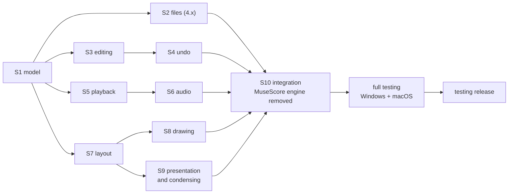

# 14 · Roadmap: a complete, independent Jubelle engine

_18 Nov 2026, from the user's instruction of 20:43, which replaces the "testing build E1" plan written earlier that
evening (D-E21 is withdrawn). The user's goal: **Jubelle has a fully independent notation engine.** In the finished
application MuseScore's engine is not responsible for editing, playback, drawing or layout. A longer timeline is
explicitly accepted; correctness, stability, performance and Jubelle's existing features come before speed._

## 1. What "independent" means here
| | In the finished Jubelle |
|---|---|
| **Replaced by the Jubelle engine** (`je::`) | score model and data management · editing and note entry · undo and redo · playback interpretation **and** audio processing (scheduling, mixing, effects, instrument hosting, audio export) · engraving and layout · page rendering and drawing · presentation and **live condensing** · file reading, writing and serialization |
| **Not linked into the app at all** | MuseScore's `engraving` library (DOM, layout, read/write, editing, playback), `framework/mpe`, `framework/audio`'s engine, `framework/draw`'s engine-facing parts |
| **Used as a reference only** | MuseScore's engine runs in the **test tools** as the comparison baseline (shadow comparisons, file round trips). It is never shipped as part of the engine |
| **Reused where licensing allows** | MuseScore's GPL v3 algorithms may be **ported** into `je::` with their notices (D-E3); independent third-party libraries keep being used through Jubelle's own code: FluidSynth (LGPL), FFmpeg (LGPL), LAME, FLAC, Vorbis, Opus, the VST3 SDK (under its licence), Qt (LGPL), SMuFL fonts (OFL) |
| **Stays as the application around the engine** | the Jubelle interface: menus, panels, dialogs, workspaces, shortcuts and the Qt/QML application framework. They are rewired from MuseScore's DOM to the Jubelle engine's API (S10) but look and work the same |

The release's own checks gain a **dependency gate**: the finished app binary must not link `engraving`, `mpe` or
MuseScore's audio engine (§5).

## 2. Subsystems, each developed and tested on its own
| # | Subsystem | Content | Independent tests | Compared against (baseline) |
|---|---|---|---|---|
| S1 | **Model and data management** (`je::model`, `je::exec`) | players, instruments, flows, voices, events, notes, attachments, spanners, tempo and meter maps, layouts; stable IDs; immutable snapshots; memory management | unit, snapshot isolation (ThreadSanitizer), memory | MuseScore's DOM, via the converter in the test tool |
| S2 | **File handling and serialization** (`je::io`) | native MuseScore 4.x `.mscz`/`.mscx` reader and writer (parts as `Excerpts/`); the engine store in meta tags; **the 11 Jubelle style settings preserved** (D-E19); then MusicXML, MIDI, older MuseScore formats (1.x–3.x), Guitar Pro and the other importers | round trips on the corpus; official MuseScore 4.7.7 opens every written file with identical MIDI; Jubelle → MuseScore save → Jubelle keeps every setting | MuseScore's reader and writer |
| S3 | **Editing and note entry** (`je::edit`) | the operation vocabulary (`10_edit_vocabulary.md`): note input (step, re-pitch, insert, real-time later), selection, copy and paste, every command and Jubelle editing feature (linked passages natively) | scripted edit sequences; property tests | the same scripts in MuseScore's engine → same music |
| S4 | **Undo and redo** (`je::edit`) | transactions, change sets, history, autosave journal and crash recovery | inverse property tests (random 10,000-step sequences); journal replay after a simulated crash | n/a (exact by construction) |
| S5 | **Playback** (`je::perform`) | interpretation: dynamics, articulations, ornaments, repeats and jumps, swing, falls and bends, Jubelle's playback rules; per-measure cached events | event-by-event tests | MuseScore's playback events (MPE), with documented differences |
| S6 | **Audio processing** (`je::audio`) | real-time scheduler, sequencer, mixer, effects (Jubelle's limiter and dynamics), instrument hosting (SoundFonts via FluidSynth, SFZ, VST3), offline rendering and export (WAV, FLAC, MP3, OGG, **AAC with FFmpeg's own encoder**, D-E15) | deterministic offline renders (sample-exact), glitch tests under load, latency | renders of MuseScore's audio engine (loudness, timing, correlation) |
| S7 | **Engraving and layout** (`je::layout`, `je::style`) | shaping (stems, beams, accidentals, ties, slurs, articulations, chords) → spacing → system breaking → vertical layout and collision avoidance → pages; Jubelle's engraving rules, courtesy accidentals, magnetic layout, jazz look | stage-by-stage unit tests; determinism; incremental equals full | MuseScore's positions (within 0.05 sp), systems and pages |
| S8 | **Page rendering and drawing** (`je::render`) | display lists with element IDs, hit testing, dirty regions; output to the screen (Qt), PDF, SVG and PNG | image diffs | MuseScore's PDF/PNG output |
| S9 | **Presentation and live condensing** (`je::present`) | layouts (full score, parts, custom), staff assignment, **condensing** (approved: configurable groups D-E12, labels "Tpt. 1.2" D-E18), divisi | the specification's tests (`04_…` §14); the condensed-copy planner's tests | the existing condensed-copy output, and the user's visual review |
| S10 | **Integration** (`je::bridge`) | the Jubelle interface moved from the DOM to the engine API (the 317 consumers of `12_bridge_migration_plan.md`), plugins, then MuseScore's engine **removed from the app build** | the full app checks and interface self-test, with the Jubelle engine only | the current release, feature by feature |

## 3. Order and dependencies

1. **S1, then S2's 4.x reader and writer.** Every later comparison needs scores loaded into the new model. The
   style-setting preservation (D-E19) is part of S2.
2. **S3 and S4** (editing and undo), with scripted comparisons.
3. **S7 and S8** (layout and drawing): the largest part, stage by stage in pipeline order.
4. **S9 condensing.** Its logic (groups, phrases, classifier, staff plans, labels) is built and tested on the model
   as soon as S1 is ready. Drawing condensed staves follows S7.
5. **S5 and S6** (playback and audio) can proceed alongside S7, since they depend only on S1.
6. **S10:** consumers move to the engine API, then MuseScore's engine is removed from the app build.
7. Full testing, then the first testing release of the new engine.

## 4. How the work proceeds
- Each subsystem lives in its own module under `jubelle_engine/`, with its own tests that run without Qt and without
  MuseScore's engine. Comparison tests that need MuseScore's engine live in a separate test tool.
- CI runs the engine suites on Windows, macOS and Linux, with ThreadSanitizer and AddressSanitizer/UBSan.
- No test is disabled or weakened to pass a milestone. Differences from MuseScore are reviewed and documented, never
  silently accepted.
- The master plan records every milestone, decision and change of direction in the same commit as the work.

## 5. Gates before any testing release (Windows and macOS)
1. Every subsystem suite green, on both platforms.
2. **Feature parity:** every Jubelle feature in `02_jubelle_integration_map.md` works on the new engine, checked by
   the existing app checks and interface self-test plus a per-feature checklist.
3. **Files:** the whole corpus round-trips. Official MuseScore 4.7.7 opens every file written, with identical MIDI,
   and Jubelle's settings survive a MuseScore save.
4. **Performance** goals (`03_…` §9) met on the large orchestra; never slower than the current release on small
   scores.
5. **Reliability:** fuzzed edit sequences, long-session memory, crash recovery, sanitizer runs.
6. **Dependency gate:** the app links none of MuseScore's engine libraries.
7. The user's hands-on test. Then a **pre-release** with its own version. Until then the stable release
   v4.7.7.261118230 remains the current Jubelle, and **no new testing release is published**.

## 6. Progress
| Subsystem | Status (19 Nov 2026) |
|---|---|
| S1 model | **foundations complete**: persistent model, O(1) snapshots, structural edits, consistency rules, bulk building, notation coverage (tuplets, graces, ties, lyrics, chord symbols, repeats, voltas, instrument changes, spanners, layouts); orchestra model 23.9 MB. Next: typed views, layout-related fields as S7 needs them |
| S2 files | **4.x reading and writing complete**: archives, engine store, the MuseScore 4.x reader (**2,109 of 2,118 identical to MuseScore's own reading**) and the model-based writer (D-E27, D-E28): **2,118 of 2,118 regenerate exactly; MuseScore reads 2,110 of 2,117 generated files as the originals**; parts generated and linked; save-and-reopen tests; the 11 style settings through saving and MuseScore (`15_file_handling.md`). Next: part-only content, older formats, MusicXML, MIDI |
| S3 editing | **in progress**: the operation vocabulary with MuseScore's note-entry rules (`edit/operations`: entering chords and rests over existing music, ties across barlines, notes in chords, pitches and spellings, deletion, values, tuplets, inserting and removing measures, transposition) and note input (`edit/noteinput`: letters, octaves, keys, accidentals, chords, values, rests, ties, arrows, re-pitch, tuplets); range copy, paste and delete (`edit/clipboard`); **linked staves while editing** (`edit/links`: an edit on either staff of a linked pair is made on the other in the same undo step; copies linked as MuseScore links them, by identity from 4.60 and by place before) and **tablature strings and frets** (`edit/tablature`, MuseScore's fretting rules); **editing commands** (`edit/commands`: enharmonic spelling, accidentals, add interval, articulations, change and swap voices, grace notes, lines, slurs, glissandos, key signatures, clefs) and note entry on a staff with its own (local) time signature; **time signature changes** with MuseScore's rewriteMeasures and ScoreRange rules (notes split and tied at the new barlines, rests joined and split as MuseScore reads and writes a range, tuplets split at their middle, pickups, the same length only renamed, repeats, breaks, voltas, rehearsal marks and part breaks kept, the change refused where MuseScore refuses it); compared with MuseScore's own command on every corpus score (5/8 from bar 2: 2,088 of 2,111 the same; 3/4 from bar 1: 2,077 of 2,112) and MuseScore reads every saved result with the same music (CI); property tests of random edit sequences (consistent after every step, exact undo and redo, saved and reopened with the same music); all 138 corpus scores with a linked staff edited on both staves and read by MuseScore with the same music and the same links (CI); every corpus score edited with the commands and read by MuseScore with exactly the edited music (1,486 of 1,489; the other 3 already differ unedited) (CI). Next: the remaining commands of `10_…` (split and join measures, explode and implode, slashes, lyrics and text), lines and staff texts mirrored on linked staves, then the scripted comparison with MuseScore's engine |
| S4–S10 | not started |

## 7. Scale and timeline
MuseScore's engine is about 260,000 lines, built over many years. This is a long programme, realistically many months
of work. No dates are promised: progress is reported per milestone, with measured results. The work is ordered so
that each finished subsystem is complete and tested on its own.
